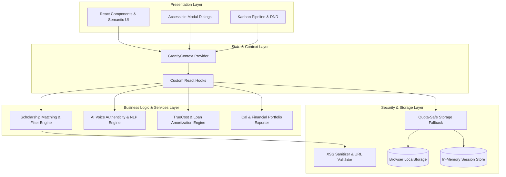
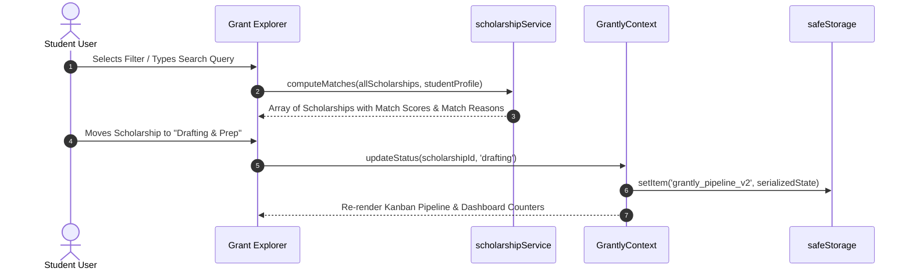

# 🏛️ Architecture & System Design — GRANTLY

This document details the architectural principles, software patterns, data flow pipelines, state management strategy, and security boundaries implemented in **GRANTLY: Rethinking the Scholarship Experience**.

---

## 📐 High-Level Architecture Overview

GRANTLY follows an **Enterprise Clean Architecture** pattern tailored for modern single-page web applications. The design strictly separates concerns into decoupled layers:

---

## 🧩 C4 Component Diagram

### 1. Presentation Layer (`src/components/`)
- **`Navbar.tsx`**: Semantic `<header role="banner">` with responsive navigation tabs, live unread counters, dark/light theme switch, and user authentication status.
- **`GrantExplorer.tsx`**: High-performance scholarship discovery engine featuring faceted filtering, instant text search with debouncing, category tags, and urgency indicators.
- **`ScholarshipCard.tsx`**: Reusable `<article>` landmark displaying match score badge, renewability indicators, deadline countdown, and direct action triggers.
- **`ScholarshipDetailModal.tsx`**: Accessible dialog (`role="dialog"`, `aria-modal="true"`) presenting criteria verification, application prompt breakdowns, and direct external portal links.
- **`PipelineKanban.tsx`**: 5-column application lifecycle workflow with drag/drop stage transitions, milestone sub-checklists, deadline urgency badges, and celebration particle confetti.
- **`GrantWriterStudio.tsx`**: Narrative co-pilot equipped with real-time AI Voice Authenticity analysis, Flesch Reading Ease computation, anti-cliché detection, and 4-beat narrative outlines.
- **`AidStackingCalculator.tsx`**: TrueCost financial modeler, award stacking simulator, student loan repayment & debt freedom timeline, and institutional scholarship displacement appeal generator.
- **`DocumentVault.tsx`**: Document management locker for transcripts, resumes, and personal statements, plus automated faculty recommendation letter follow-up email generator.
- **`LoginPage.tsx`**: Authentication portal with multi-method sign-in, 1-click persona quick-logins, and guest exploration mode.
- **`StudentProfileModal.tsx`**: Profile editor for configuring GPA, major, academic year, citizenship, residency, and household income.

### 2. State & Context Layer (`src/context/` & `src/hooks/`)
- **`GrantlyContext.tsx`**: Enterprise React Context providing a single source of truth for global state, eliminating prop drilling while preserving component isolation.
- **`useScholarships.ts`**: Encapsulates state for scholarship queries, filter matrices, active statuses, custom notes, and milestone checklists.
- **`useStudentProfile.ts`**: Manages active student profile configuration, persona preset switching, and reactive match score recomputations.
- **`useDocumentVault.ts`**: Manages student document inventory and faculty recommendation request statuses.
- **`useDarkMode.ts`**: Manages system/user theme preferences with `prefers-color-scheme` synchronization.
- **`useDebounce.ts`**: Debounces rapid user keystrokes in search queries to conserve CPU cycles.

### 3. Business Logic & Domain Services (`src/services/`)
- **`scholarshipService.ts`**: Pure functional domain service handling:
  - Multi-variable weighted match scoring (GPA, major, academic level, residency, household income).
  - Multi-attribute faceted filtering and full-text fuzzy search.
  - Pipeline stage grouping and aggregated total awarded metric computations.
- **`aiAnalysisService.ts`**:
  - **Flesch Reading Ease Calculator**: Computes syllable-to-sentence complexity.
  - **Voice Authenticity Index (0-100%)**: Detects and penalizes overused academic clichés ("passion for STEM", "beacon of hope", "broaden my horizons", "ever since I was a child") while rewarding concrete quantitative evidence and active voice.
  - **Narrative Architecture Generator**: Synthesizes structured 4-beat essay blueprints (*The Hook*, *The Crucible*, *Community Multiplier*, *Future Vision*).
- **`aidCalculationService.ts`**:
  - Cost of Attendance (COA) total calculation.
  - Layered financial aid stacking and unmet financial gap derivation.
  - **Loan Amortization & Debt Freedom Timeline**: Simulates standard 10-year repayment schedules at 6.8% APR, calculating the exact **years shaved off repayment** and **compounded interest saved** by winning scholarships.
  - Institutional displacement risk detection with statutory CFR Title 34 appeal template generation.
- **`exportService.ts`**:
  - Generates RFC 5545 compliant `.ics` calendar events for scholarship application deadlines.
  - Synthesizes formatted, printable plain-text Financial Aid Portfolio summaries.

### 4. Security & Storage Layer (`src/utils/`)
- **`security.ts`**:
  - `sanitizeText()`: Defense-in-depth HTML entity encoding to prevent Cross-Site Scripting (XSS).
  - `safeUrl()`: URL protocol whitelist validator allowing only `https://` and `mailto:` schemes.
  - `clampGpa()`: Strict numeric boundary enforcement for academic metrics (0.00 – 4.00).
  - `safeStorage`: Resilient wrapper around `window.localStorage` with automatic fallback to an in-memory dictionary when storage quotas are exceeded or when running in private browsing modes.

---

## 🔄 Data Flow Pipeline

---

## 🔒 Security Architecture & FERPA Compliance

1. **Zero External Tracking**: Grantly transmits zero Personally Identifiable Information (PII) to third-party tracking services or ad networks.
2. **Client-Side Data Ownership**: Student financial records, household income, GPA, and essay drafts remain locally isolated on the client's device.
3. **Content Security Policy (CSP)**:
   - `default-src 'self'`
   - `script-src 'self' 'unsafe-inline'`
   - `style-src 'self' 'unsafe-inline' https://fonts.googleapis.com`
   - `font-src 'self' https://fonts.gstatic.com`
   - `img-src 'self' data: https:`
   - `object-src 'none'`
4. **Link Hygiene**: All external hyperlinks utilize `rel="noopener noreferrer"` and pass through `safeUrl()` validation.

---

## ⚡ Performance Optimization Strategy

| Metric | Target | Optimization Implemented |
| :--- | :--- | :--- |
| **First Contentful Paint (FCP)** | < 1.0s | Preconnected Google Fonts, zero external CSS bloat, inline SVG icons. |
| **Cumulative Layout Shift (CLS)** | 0.00 | Explicit card min-heights, skeleton loading states, CSS grid constraints. |
| **Bundle Size** | < 120 kB | Vite Rollup manual chunking separating React runtime, Lucide icons, and Confetti. |
| **Interaction to Next Paint (INP)** | < 50ms | Debounced search input (250ms), pure functional memoized match calculations. |

---

## 🧪 Testing & Verification Architecture

The test suite located in `tests/` executes hermetic, deterministic unit tests across all critical algorithms without external DOM dependencies:
- **`matchEngine.test.js`**: Validates multi-variable GPA thresholds, major classification, and residency criteria.
- **`aidCalculations.test.js`**: Validates financial aid gap mathematics, loan amortization payoff timelines, and interest reduction formulas.
- **`securitySanitization.test.js`**: Validates XSS injection stripping, malicious protocol neutralizing, and GPA clamp boundaries.
